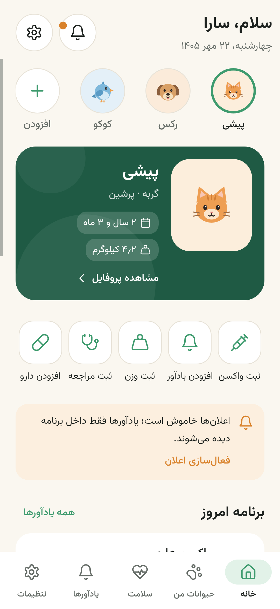
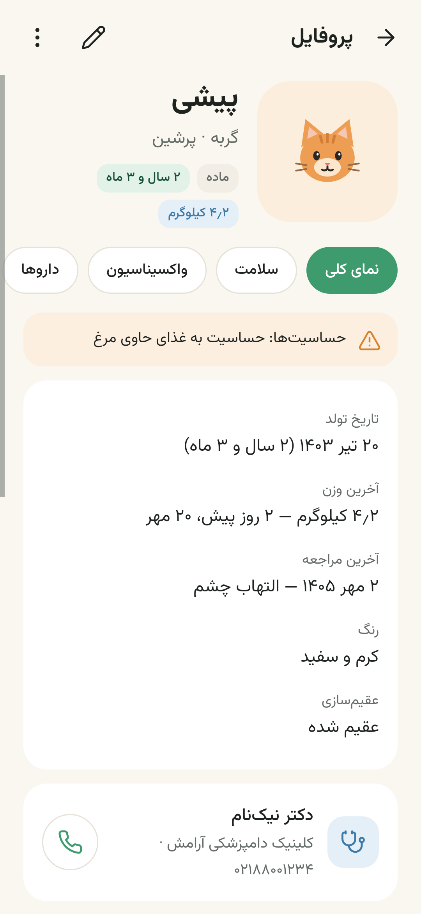
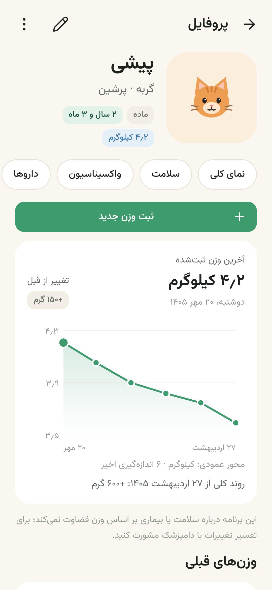
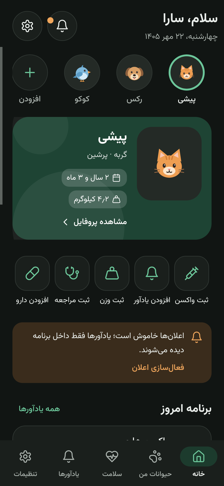

# پنجه — دستیار سلامت و مراقبت حیوان خانگی

اپلیکیشن اندرویدی **کاملاً فارسی و راست‌چین** برای مدیریت سلامت، واکسن، دارو، مراجعات دامپزشکی، وزن، یادآورها و مدارک حیوانات خانگی.
همه اطلاعات فقط روی گوشی کاربر ذخیره می‌شود؛ برنامه مجوز اینترنت ندارد.

<p align="center">
  
  
  
  
</p>

## اقلام تحویلی و مسیر دقیق آن‌ها

| # | مورد | مسیر |
|---|------|------|
| ۱ | سورس کامل پروژه | همین مخزن (`app/`، `tools/`) |
| ۲ | فایل APK امضاشده و قابل نصب (نسخه انتشار) | `dist/panjeh-1.0.0-release.apk` |
| ۳ | فایل مناسب انتشار در فروشگاه | همان APK بالا (ساخت AAB در این محیط ممکن نبود؛ توضیح در `docs/RELEASE_INFO.md`) |
| ۴ | آیکون برنامه | منبع برداری: `app/src/main/res/drawable/ic_launcher_*.xml` — آیکون فروشگاه: `docs/store/icon-512.png`، `docs/store/icon-512-rounded.png` |
| ۵ | اسکرین‌شات صفحات واقعی | `docs/screenshots/` (۲۵ تصویر) و تصویر شاخص `docs/store/feature-graphic-1024x500.png` |
| ۶ | راهنمای نصب و اجرا | همین فایل (بخش «نصب») |
| ۷ | مستندات ساخت پروژه | `docs/BUILD.md` |
| ۸ | مستندات پایگاه داده | `docs/DATABASE.md` |
| ۹ | فهرست مجوزهای اندروید | `docs/PERMISSIONS.md` |
| ۱۰ | گزارش تست | `docs/TEST_REPORT.md` |
| ۱۱ | راهنمای نسخه پشتیبان | `docs/BACKUP_GUIDE.md` |
| ۱۲ | اطلاعات نسخه و شناسه بسته | `docs/RELEASE_INFO.md` |
| ۱۳ | توضیحات فارسی صفحه مایکت | `docs/MYKET_LISTING.md` |
| ۱۴ | قابلیت‌های تکمیل‌شده | `docs/FEATURES.md` |
| ۱۵ | قابلیت‌های تکمیل‌نشده یا نیازمند بررسی | `docs/FEATURES.md` (بخش دوم) |
| — | سیستم طراحی | `docs/DESIGN.md` |
| — | متن سیاست حریم خصوصی (برای فروشگاه) | `docs/PRIVACY_POLICY.md` |
| — | صفحه معرفی (لندینگ) آماده انتشار روی وب | `landing/` (کل پوشه را روی هاست قرار دهید؛ `index.html` + تصاویر + فایل APK) |

## نصب

1. فایل `dist/panjeh-1.0.0-release.apk` را به گوشی اندرویدی (نسخه ۸٫۰ یا جدیدتر) منتقل کنید.
2. با لمس فایل، نصب را تأیید کنید (در صورت درخواست، اجازه «نصب از منابع ناشناخته» را برای برنامه مدیریت فایل بدهید).
3. برنامه «پنجه» را از فهرست برنامه‌ها اجرا کنید.

> نسخه انتشار با کلید اختصاصی پروژه امضا شده است. اگر قبلاً نسخه‌ای با کلید دیگری نصب کرده‌اید، ابتدا آن را حذف کنید.

## ساخت سریع از سورس

```bash
sudo apt-get install aapt dalvik-exchange zipalign apksigner   # ابزارهای اندروید (اوبونتو/دبیان)
gradle :app:assembleDebug        # APK اشکال‌زدایی
gradle :app:test                 # همه تست‌ها + تولید اسکرین‌شات‌ها
gradle :app:assembleRelease      # APK انتشار (نیازمند keystore.properties)
```

جزئیات کامل، از جمله دلیل ساخت بدون Android Gradle Plugin، در `docs/BUILD.md` آمده است.

## فناوری

- **Kotlin** + APIهای بومی فریم‌ورک اندروید (بدون AndroidX)، رابط کاربری برنامه‌نویسی‌شده با سیستم طراحی اختصاصی
- **SQLite** (فریم‌ورک) برای ذخیره‌سازی پایدار، **AlarmManager** و **Notification** برای یادآورها
- فونت **وزیرمتن**، تقویم **شمسی** با پیاده‌سازی داخلی، ساعت ۲۴ ساعته و ارقام فارسی در کل برنامه
- تست با **JUnit** و **Robolectric** (اجرای واقعی Activity و رندر بومی)

## وضعیت

نسخه ۱٫۰٫۰ — همه قابلیت‌های اصلی پیاده‌سازی و با تست خودکار بررسی شده‌اند.
**روی گوشی واقعی یا شبیه‌ساز اجرا نشده است** (در محیط ساخت در دسترس نبود)؛ چک‌لیست تست دستی پیش از انتشار در `docs/TEST_REPORT.md` آمده است.
