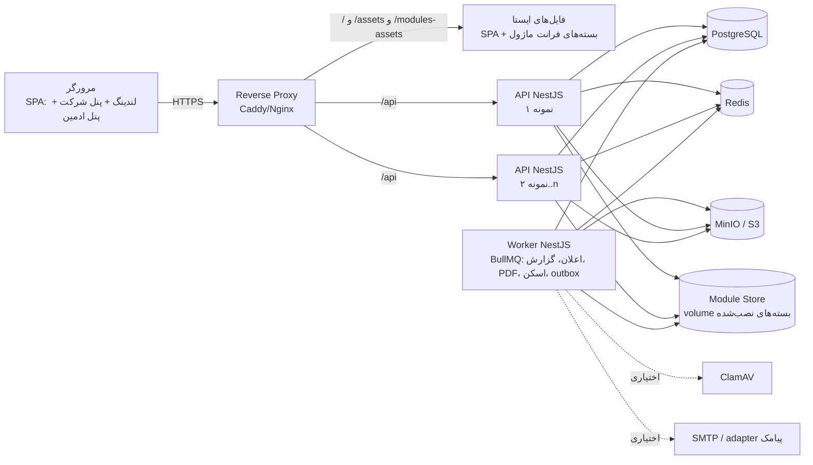
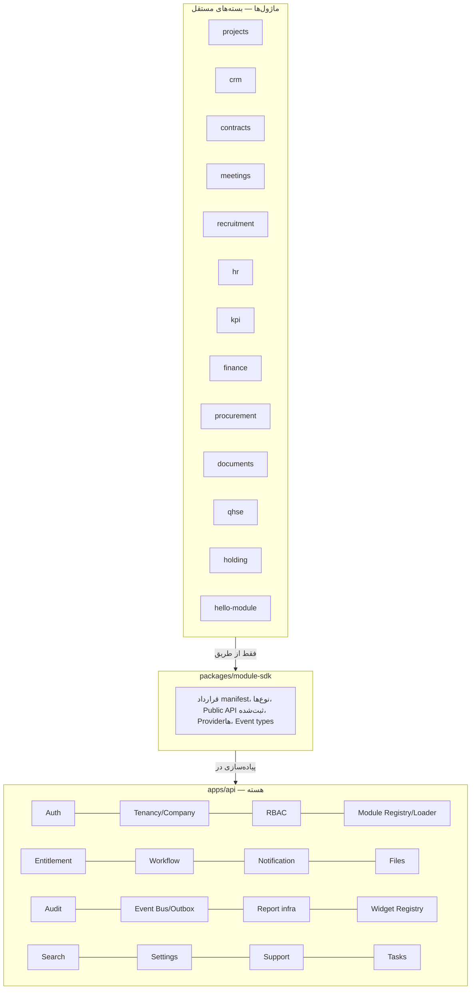
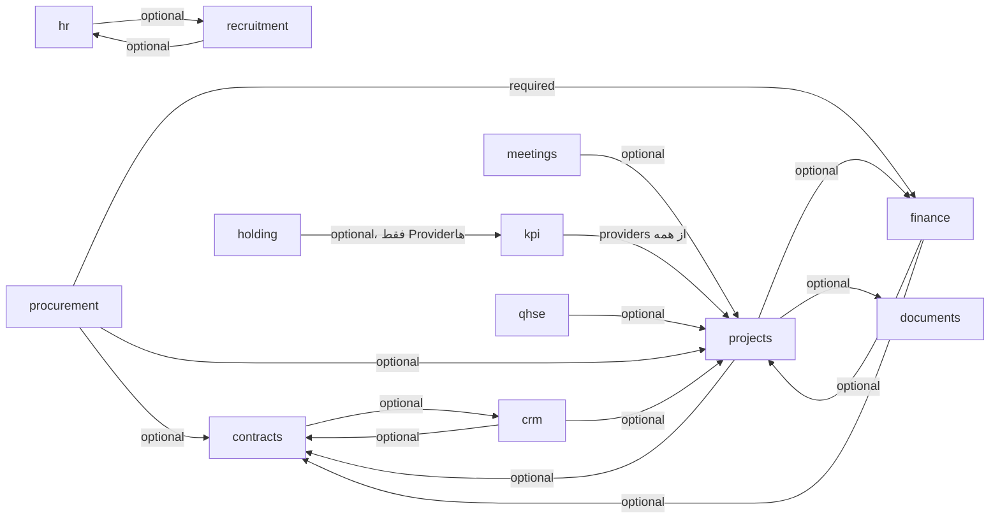

# ۰۲ — معماری کلان

> وضعیت: پیش‌نویس فاز ۰ — منتظر تأیید

## ۱. نمای کلی استقرار



- **API** و **Worker** از یک کدبیس و یک image ساخته می‌شوند؛ فقط نقش اجرا (`APP_ROLE=api|worker`) فرق دارد. هر دو ماژول‌های نصب‌شده را از Module Store بارگذاری می‌کنند.
- فرانت ماژول‌ها به‌صورت فایل ایستا از همان origin سرو می‌شوند (CSP `script-src 'self'` حفظ می‌شود).
- همه سرویس‌ها خودمیزبان‌اند. هیچ درخواست خروجی در حالت پیش‌فرض وجود ندارد.

## ۲. لایه‌بندی منطقی



قاعده جهت وابستگی (اجباری در CI):

- `apps/api/src/core/**` ← نباید هیچ import از `modules/**` داشته باشد.
- `modules/X/**` ← فقط می‌تواند از `@mohandesyar/module-sdk`، `@mohandesyar/shared-types`، `@mohandesyar/ui` (فرانت) و کتابخانه‌های مجاز import کند. import از `modules/Y` یا `apps/**` ممنوع است.
- ارتباط X↔Y: فقط Public API ثبت‌شده در رجیستری (`ctx.services.get('crm.customers', '^1')`)، رویداد، یا Provider.

## ۳. تصمیم‌های کلیدی (ADR خلاصه)

| # | تصمیم | دلیل | جایگزین ردشده |
|---|---|---|---|
| ADR-01 | **Drizzle ORM** (+ drizzle-kit فقط برای تولید SQL) | (۱) اسکیمای TypeScript در هر ماژول، بدون client تولیدشده سراسری — ماژولی که در زمان اجرا نصب می‌شود نمی‌تواند Prisma Client هسته را بازتولید کند؛ (۲) پشتیبانی بومی از `pgPolicy`/RLS؛ (۳) `set_config` در تراکنش ساده و صریح؛ (۴) خروجی مهاجرت SQL خام که می‌توانیم با runner خودمان به تفکیک ماژول اجرا کنیم. | Prisma: client کامپایل‌شده برای یک اسکیمای واحد، مهاجرت‌ها یک تاریخچه سراسری، RLS فقط با SQL دستی و `$transaction` تعاملی. |
| ADR-02 | **Runner مهاجرت اختصاصی** روی فایل‌های SQL هر ماژول، با جدول دفتر `core_module_migrations` | نیاز به مهاجرت مستقل هر ماژول، اجرای تراکنشی هنگام نصب، و بررسی‌های پس از مهاجرت (RLS اجباری) | drizzle-kit migrate (یک جدول سراسری، بدون hook) |
| ADR-03 | **بارگذاری بک‌اند: dynamic `import()` + ری‌استارت کنترل‌شده** برای نصب/ارتقا/حذف کد؛ **بدون ری‌استارت** برای فعال/غیرفعال‌سازی | NestJS پس از `app.init()` افزودن کنترلر/مسیر جدید را پشتیبانی رسمی نمی‌کند؛ hack روی router داخلی Express/Fastify شکننده است. فعال/غیرفعال‌سازی در زمان اجرا با Guard انجام می‌شود. جزئیات: سند ۰۳ | LazyModuleLoader (فقط provider، نه controller)؛ دستکاری router |
| ADR-04 | **فرانت ماژول: ESM ساخته‌شده با esbuild + import map** برای کتابخانه‌های مشترک (فاز ۱: به‌جای Vite library mode — خروجی ESM یکسان با تنظیم ساده‌تر در `module:pack`) | استاندارد مرورگر، بدون runtime اضافه، SPA میزبان نیاز به build مجدد ندارد؛ ساده‌تر از Module Federation | Module Federation (`@module-federation/vite`): runtime و پیکربندی پیچیده‌تر؛ به‌عنوان مسیر پشتیبان نگه داشته می‌شود |
| ADR-05 | **امضای بسته با Ed25519** (`node:crypto`) روی فایل CHECKSUMS (SHA-256 همه فایل‌ها) | بدون وابستگی خارجی، کلید کوچک، سریع، پشتیبانی چرخش کلید | GPG (وابستگی باینری)، Sigstore (وابسته به سرویس آنلاین) |
| ADR-06 | **RLS بر اساس `set_config('app.tenant_id', …, true)`** در هر تراکنش؛ نقش دیتابیس اپ بدون BYPASSRLS و غیرمالک جداول؛ `FORCE ROW LEVEL SECURITY` | لایه دفاعی دوم واقعی حتی در صورت باگ سرویس | schema-per-tenant (مهاجرت N برابر، با نصب پویای ماژول ناسازگار) |
| ADR-07 | **Event Bus درون‌فرایندی + Transactional Outbox** → BullMQ برای مصرف‌کننده‌های async | تضمین at-least-once بدون از دست رفتن رویداد هنگام rollback تراکنش | Kafka/NATS (بار عملیاتی زیاد برای مشتری خودمیزبان) |
| ADR-08 | **PDF با Chromium headless (Playwright) در Worker** | تنها راه قابل اتکا برای شکل‌دهی درست حروف فارسی، RTL و فونت جاسازی‌شده | pdfmake/pdfkit (شکل‌دهی ضعیف عربی/فارسی)، Gotenberg (قابل قبول، کانتینر اضافه — گزینه دوم) |
| ADR-09 | **اعلان لحظه‌ای با SSE** | یک‌طرفه کافی است، از پشت proxy ساده‌تر از WebSocket، بدون کتابخانه | WebSocket/Socket.IO |
| ADR-10 | **Fastify** به‌عنوان adapter HTTP در NestJS | کارایی بهتر، پشتیبانی stream برای آپلود بسته و فایل | Express (قابل قبول) |
| ADR-11 | **جست‌وجو: `tsvector` با پیکربندی `simple` + نرمال‌سازی فارسی در اپ + `pg_trgm`** | PostgreSQL دیکشنری فارسی ندارد؛ نرمال‌سازی (ی/ي، ک/ك، نیم‌فاصله، ارقام، اعراب) در اپ و trigram برای تطبیق ناقص | Elasticsearch/Meilisearch (سرویس اضافه؛ خلاف حداقل‌گرایی) |
| ADR-13 | **نقش `mohandesyar_definer` (NOLOGIN، BYPASSRLS)** مالک چند تابع SECURITY DEFINER که باید بین Tenantها بخوانند (عضویت‌های کاربر هنگام ورود، claim کردن outbox، آمار مصرف، زنجیره Audit) | FORCE RLS حتی مالک جدول را محدود می‌کند؛ تابع متعلق به owner چیزی نمی‌دید. فقط owner عضو این نقش است و EXECUTE فقط به app داده شده | برداشتن FORCE (تضعیف لایه دوم) |
| ADR-14 | **بارگذاری بک‌اند ماژول با `require(esm)` بومی Node** (≥ 22.12) به‌جای `import()` پویا، همراه `module.registerHooks` | در محیط تست و تولید یکسان کار می‌کند و hook همگام حل وابستگی‌ها را پوشش می‌دهد؛ محدودیت: top-level await در بسته بک‌اند ممنوع | `import()` (در sandbox تست‌رانر کار نمی‌کند) |
| ADR-12 | **Auth: JWT دسترسی کوتاه‌عمر (۱۰ دقیقه) در حافظه + Refresh Token چرخشی در کوکی httpOnly** با تشخیص استفاده مجدد | امن در برابر XSS برای refresh، پشتیبانی «خروج از همه دستگاه‌ها» از طریق جدول نشست | Session cookie کامل (با چند نمونه API نیاز به Redis session؛ قابل قبول اما refresh الگوی رایج‌تر برای SPA) |

## ۴. ساختار نهایی مخزن

```
mohandesyar/
├─ apps/
│  ├─ web/                      # SPA: Vite + React + React Router (data router)
│  │  ├─ src/areas/public/      # لندینگ (prerender ایستا با اسکریپت داخلی scripts/prerender.mjs)
│  │  ├─ src/areas/app/         # پنل شرکت
│  │  ├─ src/areas/admin/       # پنل ادمین پلتفرم
│  │  ├─ src/module-host/       # بارگذار پویای فرانت ماژول‌ها
│  │  └─ shared-vendor/         # build ESM کتابخانه‌های مشترک برای import map
│  └─ api/                      # NestJS (Fastify)
│     ├─ src/core/<context>/    # auth, tenancy, rbac, modules, entitlement, workflow, ...
│     ├─ src/platform/          # پنل ادمین پلتفرم (tenants, billing, cms, health)
│     ├─ src/infra/             # db, redis, s3, mailer, pdf, logger
│     └─ migrations/core/       # مهاجرت‌های هسته
├─ packages/
│  ├─ ui/                       # سیستم طراحی (Radix + Tailwind)
│  ├─ shared-types/             # Zod اسکیماها و نوع‌های مشترک فرانت/بک
│  ├─ module-sdk/               # نوع manifest + اسکیمای Zod آن، Context ماژول، helperهای بک/فرانت
│  ├─ persian/                  # تاریخ شمسی، اعداد، نرمال‌سازی متن فارسی
│  └─ config/                   # tsconfig, eslint, tailwind preset, dependency-cruiser
├─ modules/
│  ├─ hello-module/  projects/  crm/  contracts/  meetings/  recruitment/  hr/
│  ├─ kpi/  finance/  procurement/  documents/  qhse/  holding/
│  │  └─ (هر کدام) module.manifest.json, backend/, frontend/, migrations/, seed/, tests/, docs/
├─ tools/
│  └─ module-cli/               # module:pack | module:sign | module:verify | module:keygen
├─ infra/
│  ├─ docker/                   # Dockerfileها
│  ├─ compose/                  # docker-compose.dev.yml, docker-compose.prod.yml
│  ├─ db/                       # init نقش‌ها، تنظیمات PostgreSQL
│  └─ scripts/                  # backup, restore, restore-test
├─ e2e/                         # Playwright
├─ docs/
├─ CLAUDE.md  AGENTS.md
├─ pnpm-workspace.yaml  turbo.json  package.json  pnpm-lock.yaml
```

## ۵. جریان یک درخواست API ماژول

```mermaid
sequenceDiagram
  participant C as کلاینت
  participant G as Guards (به ترتیب)
  participant H as Handler ماژول
  participant DB as PostgreSQL
  C->>G: GET /api/m/projects/v1/projects (Bearer, X-Company-Id)
  G->>G: ۱. AuthGuard: اعتبار JWT و نشست
  G->>G: ۲. TenantContext: tenant از توکن، company از هدر + بررسی عضویت
  G->>G: ۳. ModuleGuard: ماژول installed ∧ global-enabled ∧ tenant-enabled
  G->>G: ۴. EntitlementGuard: پلن/افزونه + وضعیت اشتراک (read-only پس از انقضا برای متدهای تغییردهنده)
  G->>G: ۵. PermissionGuard: مجوز + محدوده
  G->>H: ctx (tenant, company, user, scopes)
  H->>DB: BEGIN; set_config('app.tenant_id'); set_config('app.company_ids'); ...
  DB-->>H: فقط ردیف‌های مجاز (RLS)
  H->>DB: INSERT outbox (در صورت رویداد); COMMIT
  H-->>C: پاسخ
```

همه مسیرهای ماژول زیر پیشوند `/api/m/<moduleId>/v<major>/` هستند تا Guardها بتوانند ماژول را از مسیر تشخیص دهند و نسخه API ماژول مشخص باشد.

## ۶. ماژول‌ها و وابستگی‌ها



تنها وابستگی **اجباری** پیشنهادی: `procurement → finance` (سفارش خرید به بودجه و پرداخت نیاز دارد). این را در سؤال‌های باز مطرح کرده‌ام؛ جایگزین: procurement بدون finance کار کند و بخش بودجه/پرداخت پنهان شود.

حلقه‌های اختیاری (مثلاً crm↔contracts) مجاز هستند چون فقط از طریق Public API/رویداد در زمان اجرا حل می‌شوند و ترتیب نصب را تعیین نمی‌کنند. وابستگی‌های **اجباری** باید DAG باشند (در نصب بررسی می‌شود).
