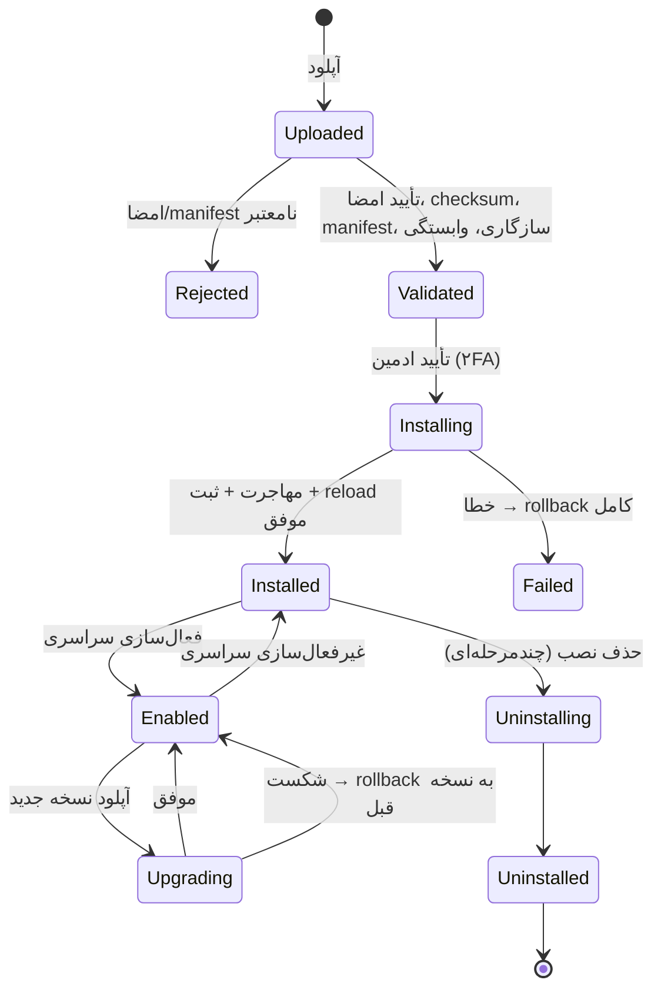

# ۰۳ — طراحی دقیق سیستم ماژول

> وضعیت: پیش‌نویس فاز ۰ — منتظر تأیید. مهم‌ترین سند پروژه.

## ۱. اصطلاحات

- **بسته (Package):** فایل `<id>-<version>.mypkg` (tar.gz) امضاشده.
- **Module Store:** volume روی سرور: `/var/lib/mohandesyar/modules/<id>/<version>/` (بسته استخراج‌شده و تأییدشده، فقط‌خواندنی برای فرایند API).
- **Registry:** جداول `core_modules*` در دیتابیس (حقیقت واحد درباره وضعیت).
- **Loader:** کدی که هنگام بوت API/Worker ماژول‌های فعال را از Store بارگذاری می‌کند.

## ۲. قرارداد manifest

فایل `module.manifest.json`، با اسکیمای Zod در `packages/module-sdk/src/manifest.ts` اعتبارسنجی می‌شود (و JSON Schema تولیدشده برای ویرایشگر).

```jsonc
{
  "$schema": "../../packages/module-sdk/manifest.schema.json",
  "manifestVersion": 1,
  "id": "projects",                       // ^[a-z][a-z0-9-]{1,30}$ ، یکتا، تغییرناپذیر
  "name": { "fa": "مدیریت پروژه", "en": "Projects" },
  "version": "1.2.0",                     // SemVer
  "description": { "fa": "…", "en": "…" },
  "publisher": { "id": "mohandesyar", "name": "…" },
  "coreVersionRange": "^1.0.0",
  "apiVersion": 1,                        // پیشوند /api/m/projects/v1
  "dependencies": { },                    // { "finance": "^1.0.0" } — اجباری
  "optionalDependencies": { "contracts": "^1.0.0", "finance": "^1.0.0", "documents": "^1.0.0" },
  "provides": {                            // Public API ثبت‌شده برای ماژول‌های دیگر
    "services": [{ "name": "projects.lookup", "version": "1.0.0" }]
  },
  "permissions": [
    { "key": "projects.project.view",   "fa": "مشاهده پروژه",  "scopes": ["company","unit","project","own"] },
    { "key": "projects.project.create", "fa": "ایجاد پروژه",  "scopes": ["company","unit"] },
    { "key": "projects.project.export", "fa": "خروجی پروژه", "scopes": ["company","unit","project"], "sensitive": false }
  ],
  "defaultRoles": [ { "key": "project_manager", "grants": ["projects.*"] } ],
  "menu": [
    { "key": "projects", "label": { "fa": "پروژه‌ها" }, "icon": "folder-kanban", "path": "/app/projects", "permission": "projects.project.view", "order": 20 }
  ],
  "routes": [
    { "path": "/app/projects/*", "entry": "frontend/routes.js", "export": "routes" }
  ],
  "widgets": [
    { "key": "projects.delayed", "title": { "fa": "پروژه‌های دارای تأخیر" }, "entry": "frontend/widgets.js", "export": "DelayedProjects",
      "permission": "projects.project.view", "sizes": ["sm","md"], "dataEndpoint": "/widgets/delayed" }
  ],
  "settings": {                              // JSON Schema محدود → فرم خودکار
    "scope": ["tenant","company"],
    "schema": { "type": "object", "properties": { "workingDays": { "type": "array", "items": { "type": "integer" }, "title": "روزهای کاری" } } }
  },
  "events": {
    "publishes": [{ "type": "projects.project.created", "version": 1 }, { "type": "projects.phase.delivered", "version": 1 }],
    "consumes":  [{ "type": "contracts.contract.signed", "version": 1, "optional": true }]
  },
  "kpiProviders":    [{ "key": "projects.physical_progress", "title": { "fa": "پیشرفت فیزیکی" }, "unit": "percent", "dimensions": ["project"] }],
  "reportProviders": [{ "key": "projects.status", "title": { "fa": "گزارش وضعیت پروژه‌ها" }, "permission": "projects.project.export" }],
  "searchProviders": [{ "key": "projects.project", "title": { "fa": "پروژه" }, "permission": "projects.project.view" }],
  "importTemplates": [{ "key": "projects.projects", "title": { "fa": "پروژه‌ها" }, "permission": "projects.project.create",
                        "columns": [{ "key": "code", "header": "کد پروژه", "required": true }, { "key": "plannedStart", "header": "شروع برنامه‌ای", "type": "date" }] }],
  "backend":  { "entry": "backend/index.mjs" },
  "frontend": { "entry": "frontend/index.js", "styles": ["frontend/style.css"] },
  "migrations": "migrations/",
  "seed": "seed/",
  "tablePrefix": "projects_",
  "disablePolicy":   { "keepData": true, "blockIfDependents": true },
  "uninstallPolicy": { "dataDefault": "keep", "allowPurge": true, "requiresBackup": true },
  "expiryPolicy":    { "mode": "read-only" },   // read-only | hidden-keep-data
  "entitlement": { "key": "mod.projects", "plans": ["basic","pro","enterprise"] }
}
```

قواعد اعتبارسنجی اضافه (فراتر از Zod):
- همه کلیدهای مجوز/ویجت/Provider/رویداد باید با `<id>.` شروع شوند.
- `tablePrefix` باید `<id با - به _>_` باشد.
- مسیرهای `entry` باید داخل بسته باشند (بدون `..` و مسیر مطلق).
- `coreVersionRange` با نسخه هسته فعلی سازگار باشد.

## ۳. فرمت بسته

```
projects-1.2.0.mypkg   (tar.gz)
├─ module.manifest.json
├─ backend/index.mjs            # ESM باندل‌شده (esbuild) — فقط import از whitelist سراسری
├─ backend/*.mjs.map            # اختیاری
├─ frontend/index.js, routes.js, widgets.js, chunks/*.js, style.css   # Vite library mode
├─ migrations/0001_init.sql, 0002_add_risks.sql, ...    # SQL خام، ترتیب‌دار
├─ migrations/meta.json         # برای هر فایل: { "file", "checksum", "down": "0002_add_risks.down.sql"|null, "kind": "expand"|"contract" }
├─ seed/roles.json, workflows.json, forms.json, kpi-templates.json
├─ docs/README.md, CHANGELOG.md, UPGRADE.md
├─ CHECKSUMS                    # sha256  مسیر  — برای همه فایل‌ها به‌جز CHECKSUMS و SIGNATURE (مرتب‌شده)
└─ SIGNATURE                    # JSON: { "alg":"ed25519", "keyId":"…", "sig":"base64(sign(CHECKSUMS))" }
```

**وابستگی‌های بک‌اند ماژول:** ماژول باندل می‌شود؛ کتابخانه‌های مشترک (`@nestjs/*`, `drizzle-orm`, `zod`, `@mohandesyar/module-sdk`, …) external هستند و از هسته resolve می‌شوند (whitelist در SDK). بقیه وابستگی‌ها داخل باندل قرار می‌گیرند. افزونه بومی (native addon) مجاز نیست.

**وابستگی‌های فرانت ماژول:** `react`, `react-dom`, `react-router`, `@tanstack/react-query`, `@mohandesyar/ui`, `@mohandesyar/module-sdk/web`, `zod`, `react-hook-form` external هستند و از import map میزبان resolve می‌شوند.

## ۴. امضا و اعتماد

- `pnpm module:keygen` → جفت‌کلید Ed25519 (خصوصی خارج از سرور، ترجیحاً روی ماشین build آفلاین).
- `pnpm module:pack <dir>` → build بک/فرانت، کپی، تولید CHECKSUMS، tar.gz قطعی (deterministic: ترتیب ثابت، mtime صفر).
- `pnpm module:sign <pkg> --key <file>` → افزودن SIGNATURE.
- `pnpm module:verify <pkg> --pub <file>` → همان منطق سرور.
- **کلیدهای مورد اعتماد** در جدول `core_trusted_keys (key_id, public_key, label, status: active|revoked, created_at)` نگهداری می‌شوند؛ مقدار اولیه از متغیر محیطی/فایل در استقرار. افزودن کلید جدید خودش عملیات حساس با ۲FA و Audit است. ابطال کلید: ماژول‌های نصب‌شده با آن کلید در پنل علامت هشدار می‌گیرند (نه غیرفعال‌سازی خودکار، قابل تنظیم).

**تأیید در سرور (ترتیب دقیق، قبل از هر اجرای کد):**
1. محدودیت حجم آپلود (پیش‌فرض ۵۰MB) و نوع فایل.
2. استخراج در پوشه موقت ایزوله با محافظت zip-slip/symlink/hardlink، سقف تعداد فایل و حجم استخراج‌شده (ضد zip-bomb)، whitelist مسیرهای سطح بالا.
3. خواندن SIGNATURE، یافتن کلید `active` با `keyId`، تأیید امضای Ed25519 روی بایت‌های CHECKSUMS.
4. تأیید SHA-256 همه فایل‌ها با CHECKSUMS و اطمینان از اینکه **هیچ فایل اضافه‌ای** خارج از فهرست نیست.
5. اعتبارسنجی manifest (Zod + قواعد اضافه).
6. فقط پس از موفقیت همه موارد: انتقال اتمیک به `modules/<id>/<version>/` (rename) با مجوز فقط‌خواندنی.

هیچ `import()` یا اجرای SQL پیش از گام ۶ انجام نمی‌شود. بسته نامعتبر حذف و رویداد `module.package.rejected` با دلیل در Audit ثبت می‌شود.

> **محدودیت صادقانه:** امضا اعتماد را ثابت می‌کند، نه بی‌خطری را. کد ماژول درون فرایند Node با همان سطح دسترسی هسته اجرا می‌شود؛ sandbox نیست. لایه‌های کاهش ریسک: RLS (ماژول نمی‌تواند از Tenant دیگر بخواند چون اتصالش زیر RLS است)، نقش دیتابیس بدون مجوز DDL در زمان اجرا، فقط نقش «مدیر فنی پلتفرم» با ۲FA، Audit. اجرای ماژول‌های شخص ثالث غیرقابل اعتماد در آینده نیازمند ایزوله‌سازی فرایندی (worker جدا) است — در ریسک‌ها ثبت شده.

## ۵. بارگذاری بک‌اند (تصمیم و محدودیت‌ها)

### روش انتخابی: «بوت از روی رجیستری» + ری‌استارت کنترل‌شده برای تغییر کد

هنگام بوت:
1. هسته متصل به DB می‌شود، `core_modules` را می‌خواند: ماژول‌هایی با `state ∈ {installed, enabled}` و `active_version`.
2. ترتیب topological بر اساس وابستگی‌های اجباری.
3. برای هر ماژول: بررسی مجدد checksum فایل‌های Store (تشخیص دستکاری روی دیسک — شامل فایل اضافه)، سپس بارگذاری `backend/index.mjs` با `require(esm)` بومی و hookهای حل وابستگی (ADR-14).
4. ماژول یک تابع `defineModule()` از SDK export می‌کند که یک **NestJS DynamicModule** برمی‌گرداند:

```ts
// modules/projects/backend/src/index.ts
import { defineModule } from '@mohandesyar/module-sdk/server';
import { ProjectsController } from './projects.controller';
export default defineModule({
  manifest,                         // import شده از json
  imports: [],
  controllers: [ProjectsController],
  providers: [ProjectsService],
  publicServices: { 'projects.lookup': ProjectsLookup },
  eventHandlers: { 'contracts.contract.signed': onContractSigned },
  kpiProviders: { 'projects.physical_progress': PhysicalProgressKpi },
  searchProviders: { 'projects.project': ProjectSearch },
  widgetData: { 'projects.delayed': DelayedWidget },
  importers: { 'projects.projects': importProjects },
});
```

**ورود داده از Excel (فاز ۵):** هسته فایل xlsx یا CSV را می‌خواند (بدون کتابخانه خارجی؛ حداکثر ۵۰۰۰ ردیف)، سطر عنوان را با `header` ستون‌ها تطبیق می‌دهد و هر خانه را بر اساس `type` تبدیل می‌کند (`text`، `integer`، `decimal`، `money`، `date` — شمسی، میلادی یا سریال Excel —، `boolean`، `enum` با `values`). سپس `importer(ctx, rows, { dryRun: true })` ماژول را صدا می‌زند تا قواعد خود (Zod، تکراری‌ها) را بررسی کند؛ فقط اگر هیچ خطایی نبود و کاربر تأیید کرد، همان importer با `dryRun: false` همه ردیف‌ها را در یک تراکنش می‌نویسد (همه یا هیچ). مجوز هر قالب در manifest است و صفحه «ورود داده از Excel» فقط قالب‌های مجاز کاربر را نشان می‌دهد.

5. AppModule با `imports: [...coreModules, ...loadedModuleDynamicModules]` ساخته می‌شود و `app.listen()`.
6. شکست بارگذاری یک ماژول: ماژول در `core_module_runtime_status` با وضعیت `load_failed` و خطا ثبت می‌شود، **بقیه سیستم بالا می‌آید**، و ماژول‌هایی که وابستگی اجباری به آن دارند نیز بارگذاری نمی‌شوند.

### چه چیزی ری‌استارت لازم دارد؟

| عملیات | ری‌استارت؟ | سازوکار |
|---|---|---|
| فعال/غیرفعال‌سازی برای یک Tenant | خیر | ModuleGuard + کش Redis (`module-state:<tenant>`)؛ پیام invalidate روی Redis pub/sub به همه نمونه‌ها |
| فعال/غیرفعال‌سازی سراسری | خیر | همان؛ کد بارگذاری‌شده می‌ماند ولی همه درخواست‌ها و رویدادها مسدود می‌شوند |
| نصب نسخه جدید (کد جدید) | **بله** | graceful reload |
| ارتقا / بازگشت نسخه | **بله** | graceful reload |
| حذف نصب | **بله** (برای تخلیه کد از حافظه) | graceful reload |

### Graceful reload
- **پیاده‌سازی فاز ۱ (node:cluster):** فرایند اصلی (primary) هیچ وضعیت برنامه‌ای ندارد و workerها را fork می‌کند. پس از هر نصب/ارتقا/بازگشت/حذف، پیام `reload` روی Redis منتشر می‌شود؛ primary هر container workerها را **یکی‌یکی** جایگزین می‌کند: worker جدید بالا می‌آید و ready می‌شود، سپس worker قدیم درخواست‌های جاری را تمام و خارج می‌شود (timeout ۳۰ث). حتی با یک worker قطعی ندارد. با چند container، هر primary مستقلاً همین کار را انجام می‌دهد.
- در Kubernetes می‌توان همین را با rollout و readiness probe انجام داد (فاز ۶).
- پنل ادمین وضعیت هر نمونه (`instanceId`, نسخه ماژول بارگذاری‌شده، زمان بوت) را از `core_module_runtime_status` نشان می‌دهد تا معلوم شود reload کامل شده است.

### چرا بارگذاری داغ (hot) واقعی نه؟
NestJS مسیرها را هنگام `init` روی Fastify ثبت می‌کند و Fastify پس از `ready()` افزودن route را ممنوع می‌کند؛ `LazyModuleLoader` فقط provider بارگذاری می‌کند نه controller؛ و ESM در Node قابل unload نیست (نسخه قدیم در حافظه می‌ماند → نشت حافظه و دو نسخه هم‌زمان). ری‌استارت کنترل‌شده ساده، قابل پیش‌بینی و با K8s سازگار است.

## ۶. بارگذاری فرانت‌اند

- SPA میزبان با `build.rollupOptions.external` برای کتابخانه‌های مشترک ساخته می‌شود و آن‌ها از `/shared/<lib>-<hash>.js` (build جدا با `apps/web/scripts/build-shared.mjs`: یک build با code splitting و یک نمونه React) از طریق `<script type="importmap">` بارگذاری می‌شوند. بنابراین میزبان و ماژول‌ها **یک نمونه** React/Router/Query دارند. import map درون‌خطی با hash در CSP مجاز می‌شود (`script-src 'self' 'sha256-…'`، بدون `unsafe-inline`).
- پس از ورود، SPA `GET /api/core/me/modules` را می‌گیرد: فهرست ماژول‌های مؤثر Tenant/کاربر با `{ id, version, frontendEntry, integrity, menu, routes, widgets }` (فیلترشده با مجوز کاربر).
- مسیرها به‌صورت lazy در data router ثبت می‌شوند:
  `lazy: () => import(/* @vite-ignore */ '/modules-assets/projects/1.2.0/frontend/routes.js')`.
- فایل‌های فرانت ماژول از Store با هدر `Cache-Control: immutable` (مسیر نسخه‌دار) سرو می‌شوند. هش SRI در پاسخ API هست و پیش از import با `fetch`+`crypto.subtle` بررسی نمی‌شود (هزینه بالا)؛ اعتماد بر مبنای same-origin و تأیید امضا در سرور است.
- خطای بارگذاری یک ماژول → ErrorBoundary همان مسیر/ویجت؛ بقیه SPA سالم می‌ماند.
- **محیط توسعه (فاز ۱):** SPA همیشه با `vite build` (حالت `--watch` در توسعه) ساخته و توسط API سرو می‌شود تا مسیر import map دقیقاً همان تولید باشد؛ HMR برای ماژول‌ها در فاز ۱ پیاده نشده است. مسیر production با E2E روی build واقعی پوشش داده می‌شود.
- **تغییر نسخه کتابخانه مشترک:** major React/Router در هسته = نسخه جدید `coreVersionRange` و نیاز به build مجدد ماژول‌ها؛ در manifest ماژول `sharedDeps` ثبت و در نصب مقایسه می‌شود.

## ۷. مهاجرت‌ها

- هر ماژول پوشه `migrations/` با SQL خام دارد (تولیدشده با drizzle-kit از اسکیمای TS ماژول، سپس بازبینی دستی).
- جدول دفتر: `core_module_migrations (module_id, file, checksum, applied_at, applied_by, duration_ms)`؛ هسته هم با `module_id='core'`.
- اجرا با نقش دیتابیس **`mohandesyar_migrator`** (مالک جداول). نقش اپ **`mohandesyar_app`** هیچ مجوز DDL ندارد.
- **همه مهاجرت‌های یک نصب/ارتقا در یک تراکنش** (PostgreSQL DDL تراکنشی دارد) به همراه ثبت رجیستری، مجوزها و seed. شکست = ROLLBACK کامل.
- **ممنوعیت‌ها (لینت مهاجرت در `module:pack` و دوباره در سرور):** `CREATE INDEX CONCURRENTLY`، `VACUUM`، `ALTER SYSTEM`، `CREATE EXTENSION` (افزونه‌ها فقط توسط هسته)، دستور روی جداولی که با `tablePrefix` ماژول شروع نمی‌شوند، `GRANT`/`ALTER ROLE`، `SET ROLE`، `COPY … PROGRAM`، `DO` blockهای حاوی موارد فوق. پارسر: `pgsql-parser`/`libpg-query` (AST، نه regex) — در فاز ۱ بررسی مجوز و نگه‌داری آن.
- **بررسی‌های پس از مهاجرت (درون همان تراکنش):**
  - هر جدول با `tablePrefix` که ستون `tenant_id` دارد باید `relrowsecurity = true` و `relforcerowsecurity = true` و حداقل یک policy داشته باشد؛ هر جدول بدون `tenant_id` باید در manifest صریحاً `globalTables` اعلام شده باشد (معمولاً هیچ). شکست = rollback.
  - `GRANT` روی جداول جدید به `mohandesyar_app` توسط **runner** (نه ماژول) انجام می‌شود.
- **ارتقا و بازگشت — قاعده Expand/Contract:**
  - مهاجرت‌های نوع `expand` (افزودن جدول/ستون nullable/ایندکس) باید با کد نسخه قبلی سازگار باشند.
  - تغییرات مخرب (حذف/تغییر نام ستون) فقط به‌صورت `contract` و دست‌کم یک نسخه minor بعد از expand مربوطه.
  - **بازگشت به نسخه قبل پس از ارتقای موفق:** اگر نسخه جدید فقط `expand` داشته → بازگشت کد بدون تغییر schema مجاز است. اگر `contract` داشته → فقط با فایل‌های `down` موجود؛ در غیر این صورت پنل گزینه بازگشت را غیرفعال و دلیل را نمایش می‌دهد (و بازیابی از پشتیبان پیش از ارتقا را پیشنهاد می‌کند).
  - پیش از هر ارتقا یک **پشتیبان منطقی جداول ماژول** (`pg_dump -t 'projects_*'`) در MinIO گرفته می‌شود (قابل غیرفعال‌سازی برای حجم بالا با هشدار).
- **چندمستاجری:** چون یک schema مشترک است، مهاجرت یک بار برای همه Tenantها اجرا می‌شود. seed مخصوص Tenant (نقش‌های پیش‌فرض، فرم‌ها) **هنگام فعال‌سازی ماژول برای هر Tenant** اجرا می‌شود (idempotent، با کلید طبیعی)، نه هنگام نصب.
- **قفل:** هر عملیات چرخه عمر با `pg_advisory_xact_lock(hash('module-lifecycle'))` سریال می‌شود.

## ۸. چرخه عمر



وضعیت per-tenant در جدول جدا: `core_tenant_modules (tenant_id, module_id, enabled, enabled_at, disabled_at, source: plan|addon|manual|trial, expires_at)`.

**ماژول مؤثر برای Tenant** = `installed` ∧ `globally_enabled` ∧ `tenant_modules.enabled` ∧ `entitled(tenant, module)` ∧ همه وابستگی‌های اجباری نیز مؤثر.

### نصب (گام‌ها و نقاط rollback)
| گام | در صورت شکست |
|---|---|
| ۱. آپلود و تأیید (بخش ۴) | حذف فایل موقت، Audit `rejected` |
| ۲. بررسی `coreVersionRange`، وابستگی‌های اجباری (نصب‌شده و نسخه سازگار)، DAG، تداخل `id`/`tablePrefix`/کلید مجوز | گزارش دلیل؛ چیزی تغییر نکرده |
| ۳. نمایش پیش‌نمایش به ادمین: مجوزها، جداول، مهاجرت‌ها، رویدادها، وابستگی‌ها | — |
| ۴. تأیید ادمین + ۲FA تازه (≤۵ دقیقه) | — |
| ۵. انتقال به Store | حذف پوشه |
| ۶. **Dry-load:** در Worker، `import()` بک‌اند در یک child process جدا و فراخوانی `defineModule()` بدون listen (تشخیص خطای بارگذاری پیش از هر تغییر در دیتابیس) | حذف پوشه Store، Audit `install_failed`؛ دیتابیس دست‌نخورده |
| ۷. تراکنش: advisory lock → مهاجرت‌ها → بررسی RLS → GRANT → ثبت مجوزها → ثبت رجیستری (`state=installed`) → Audit → COMMIT | ROLLBACK + حذف پوشه Store + Audit `install_failed` (Audit شکست در تراکنش جدا ثبت می‌شود) |
| ۸. Graceful reload و انتظار برای گزارش `loaded` از همه نمونه‌ها | اگر `load_failed`: ماژول به `failed` می‌رود، سیستم بدون آن کار می‌کند؛ ادمین می‌تواند «حذف کامل» بزند |

Dry-load پیش از مهاجرت اجرا می‌شود چون جبران شکست آن ارزان است (هنوز چیزی در دیتابیس تغییر نکرده).

### غیرفعال‌سازی
- سراسری یا per-tenant؛ هیچ داده‌ای حذف نمی‌شود.
- اگر ماژول فعال دیگری **وابستگی اجباری** به آن دارد → مسدود با فهرست وابسته‌ها (گزینه: «غیرفعال‌سازی زنجیره‌ای» با تأیید صریح و نمایش فهرست).
- وابسته‌های **اختیاری** هشدار می‌گیرند؛ قابلیت‌های وابسته در آن‌ها پنهان می‌شود (SDK: `ctx.modules.isActive('finance')`، فرانت: `useModule('finance')`).
- اثر: API → 403 با کد `MODULE_DISABLED`؛ منو/مسیر/ویجت حذف؛ رویدادهای مصرفی ماژول برای آن Tenant در outbox با وضعیت `skipped` ثبت (نه حذف) — قابل تنظیم برای بازپخش هنگام فعال‌سازی مجدد (پیش‌فرض: بازپخش نمی‌شود؛ در سؤال‌های باز).
- جست‌وجوی سراسری، گزارش‌ها و KPIهای آن ماژول حذف می‌شوند؛ KPIهای وابسته به حالت «ورود دستی» می‌روند.

### حذف نصب
چندمرحله‌ای در پنل: (۱) نمایش تعداد Tenantهای فعال (باید ابتدا برای همه غیرفعال شود) و حجم داده (`pg_total_relation_size` و تعداد ردیف تقریبی هر جدول)؛ (۲) پشتیبان‌گیری اجباری جداول ماژول به MinIO و نمایش لینک؛ (۳) انتخاب «حفظ داده» (پیش‌فرض: کد حذف، جداول می‌مانند، `state=uninstalled_data_retained`) یا «پاک‌سازی داده» (تایپ نام ماژول + ۲FA)؛ (۴) Audit؛ (۵) reload.

نصب مجدد ماژولی که داده‌اش حفظ شده: مهاجرت‌های قبلاً اجراشده (با checksum یکسان) دوباره اجرا نمی‌شوند.

## ۹. تعامل زمان اجرا (SDK)

```ts
interface ModuleContext {
  db: TenantScopedDb;               // تراکنش با tenant/company تنظیم‌شده؛ فقط جداول خود ماژول در اسکیمای Drizzle آن
  services: { get<T>(name: string, range: string): T | undefined };   // Public API سایر ماژول‌ها (undefined اگر غیرفعال)
  events: { publish(type, payload): void };   // در outbox همان تراکنش
  files: FileService; workflow: WorkflowService; notify: NotificationService;
  audit: AuditService; settings: ModuleSettings; permissions: PermissionChecker;
  modules: { isActive(id: string): boolean };
}
```

- رویدادها با اسکیمای Zod نسخه‌دار در `shared-types/events/<module>.ts` (رویداد بخشی از قرارداد عمومی ماژول است).
- Public API سرویس‌ها نسخه SemVer دارند؛ `services.get('crm.customers', '^1')` اگر نسخه ناسازگار باشد `undefined` برمی‌گرداند.
- هیچ ماژولی به آبجکت Drizzle کامل یا connection pool دسترسی ندارد؛ `TenantScopedDb` فقط در قالب تراکنش با زمینه تنظیم‌شده فراهم می‌شود.

## ۱۰. hello-module

ماژول آموزشی کامل که همه قابلیت‌ها را با کمترین منطق نشان می‌دهد: یک جدول `hello_notes` با RLS، CRUD، یک مجوز، یک آیتم منو، یک صفحه، یک ویجت (تعداد یادداشت‌ها)، یک تنظیم (`greeting`)، انتشار رویداد `hello.note.created` و مصرف آن برای اعلان، یک search provider، یک KPI provider (تعداد یادداشت‌ها)، seed یک نقش، و دو مهاجرت (expand در نسخه 1.1.0 برای تست ارتقا). `docs/module-developer-guide.md` گام‌به‌گام: ساخت → تست → pack → sign → نصب از پنل.

همچنین fixtureهای تست: `hello-module-bad-migration` (مهاجرت عمداً خراب برای تست rollback)، بسته بدون امضا، بسته با امضای کلید ناشناس، بسته دستکاری‌شده پس از امضا.

## ۱۱. ماژول‌های رسمی و dogfooding

همه ماژول‌های `modules/*` با همان `module:pack` بسته‌بندی و با کلید رسمی امضا می‌شوند. image استقرار شامل پوشه `preinstalled/*.mypkg` است؛ در اولین بوت (یا با `pnpm platform:bootstrap`) دقیقاً همان مسیر نصب (تأیید امضا → مهاجرت → ثبت) اجرا می‌شود، فقط بدون مرحله تأیید تعاملی.
