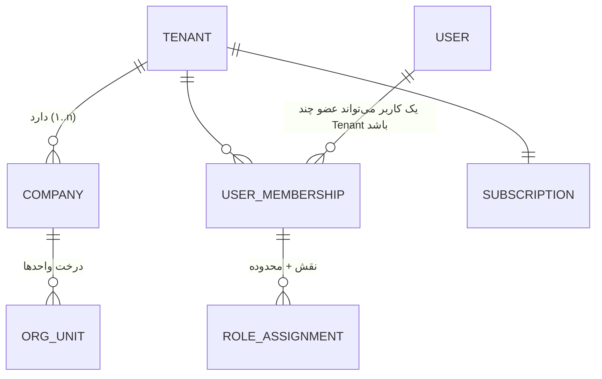

# ۰۴ — مدل چندمستاجری، هلدینگ و سیاست‌های RLS

> وضعیت: پیش‌نویس فاز ۰ — منتظر تأیید

## ۱. مفاهیم



- **Tenant:** واحد صورتحساب و جداسازی داده (مشتری). یک شرکت مستقل = Tenant با یک Company. هلدینگ = Tenant با چند Company.
- **Company:** شخصیت حقوقی زیرمجموعه. هر داده سازمانی هم `tenant_id` و هم `company_id` دارد (به‌جز داده‌های سطح Tenant مثل تنظیمات Tenant و کاربران).
- **User:** هویت سراسری (ایمیل/موبایل یکتا در کل پلتفرم)؛ عضویت در Tenant از طریق `core_memberships`. توکن همیشه به **یک Tenant** محدود است (انتخاب Tenant پس از ورود اگر چند عضویت دارد).

## ۲. زمینه درخواست

1. JWT شامل `sub` (user), `tid` (tenant), `sid` (session), `amr` (روش احراز، برای ۲FA).
2. هدر `X-Company-Id` شرکت فعال را تعیین می‌کند (یا `all` برای نمای تجمیعی در صورت داشتن مجوز `core.company.cross_view`).
3. سرور مجموعه شرکت‌های مجاز `allowedCompanyIds` را از نقش‌ها و **grantهای بین‌شرکتی** محاسبه می‌کند (کش Redis، invalidate با تغییر نقش).
4. هر تراکنش دیتابیس:

```sql
SELECT set_config('app.tenant_id',   $1, true);   -- uuid
SELECT set_config('app.company_ids', $2, true);   -- '{uuid,uuid}' (آرایه متنی)
SELECT set_config('app.user_id',     $3, true);
```

`true` = محلی برای تراکنش (معادل `SET LOCAL`)؛ با connection pooling (PgBouncer در حالت transaction) امن است چون با پایان تراکنش پاک می‌شود.

## ۳. نقش‌های دیتابیس

| نقش | کاربرد | ویژگی |
|---|---|---|
| `mohandesyar_owner` | مالک schema و جداول؛ فقط اجرای مهاجرت | هرگز توسط اپ زمان اجرا استفاده نمی‌شود |
| `mohandesyar_migrator` | runner مهاجرت (عضو owner) | فقط در فرایند مهاجرت/نصب ماژول (Worker با اتصال جدا) |
| `mohandesyar_app` | API و Worker | `NOBYPASSRLS`، غیرمالک، فقط DML روی جداول مجاز؛ INSERT/SELECT فقط روی Audit |
| `mohandesyar_platform` | عملیات پلتفرم روی جداول سطح پلتفرم (tenants, plans, modules) | بدون دسترسی به جداول ماژول‌ها؛ برای پنل ادمین |
| `mohandesyar_backup` | pg_dump | فقط‌خواندنی، `BYPASSRLS` (تنها نقش با این ویژگی؛ فقط در کانتینر backup) |

## ۴. سیاست‌های RLS

### الگوی استاندارد برای هر جدول سازمانی (ماژول یا هسته)

```sql
ALTER TABLE projects_projects ENABLE ROW LEVEL SECURITY;
ALTER TABLE projects_projects FORCE ROW LEVEL SECURITY;

-- لایه ۱: جداسازی Tenant (اجباری برای همه جداول دارای tenant_id)
CREATE POLICY tenant_isolation ON projects_projects
  AS RESTRICTIVE
  USING      (tenant_id = current_setting('app.tenant_id', true)::uuid)
  WITH CHECK (tenant_id = current_setting('app.tenant_id', true)::uuid);

-- لایه ۲: محدوده شرکت (اجباری برای جداول دارای company_id)
CREATE POLICY company_scope ON projects_projects
  AS PERMISSIVE
  USING      (company_id = ANY (current_setting('app.company_ids', true)::uuid[]))
  WITH CHECK (company_id = ANY (current_setting('app.company_ids', true)::uuid[]));
```

- جدول سازمانی **بدون** `company_id` (سطح Tenant) به‌جای `company_scope` یک policy مجاز `tenant_rows` با `USING (true)` می‌گیرد؛ چون PostgreSQL بدون حداقل یک policy مجاز (PERMISSIVE) هیچ ردیفی برنمی‌گرداند، و policy محدودکننده Tenant همچنان اعمال می‌شود.
- `current_setting(..., true)` اگر تنظیم نشده باشد NULL برمی‌گرداند → مقایسه NULL → **هیچ ردیفی** (fail-closed). یعنی فراموش کردن تنظیم زمینه منجر به نشت نمی‌شود بلکه به نتیجه خالی/خطای INSERT.
- برای کارایی: همه ایندکس‌های جداول سازمانی با `tenant_id` (و در صورت نیاز `company_id`) شروع می‌شوند.
- SDK برای ماژول‌ها helper `tenantTable()` در Drizzle دارد که ستون‌ها و `pgPolicy`ها را خودکار اضافه می‌کند؛ بررسی پس از مهاجرت (سند ۰۳ §۷) وجود آن را تضمین می‌کند.

### محدوده‌های ریزتر (واحد/پروژه/خود)
در **سرویس** اعمال می‌شوند (نه RLS)، چون منطق آن‌ها ماژول‌محور است (مثلاً عضویت در تیم پروژه). RLS مرز Tenant و Company را تضمین می‌کند؛ مرزهای ریزتر با PermissionGuard + فیلترهای Query Builder SDK (`scopeFilter(ctx, 'projects.project.view')`) و تست‌های مجوز.

### جداول بدون tenant_id
فقط جداول سطح پلتفرم (`core_tenants`, `core_plans`, `core_modules`, `core_users` …) — با پیشوند `core_` / `platform_` و دسترسی کنترل‌شده نقش. `core_users` اطلاعات حداقلی (ایمیل، موبایل، hash رمز) دارد و `mohandesyar_app` فقط از طریق تابع `SECURITY DEFINER` محدود (`auth_lookup_user`) آن را برای ورود می‌خواند.

## ۵. مدل هلدینگ و دسترسی بین‌شرکتی

- جدول `core_company_grants (tenant_id, grantee_type: user|role, grantee_id, source_company_id, scope: jsonb, permissions: text[], valid_from, valid_to, created_by, approved_by)`.
  - مثال: نقش «مدیرعامل هلدینگ» مجوز `*.view` و `*.export` روی همه شرکت‌ها؛ «مدیر مالی شرکت الف» مجوز `finance.report.view` روی شرکت ب تا پایان سال.
- `allowedCompanyIds` = شرکت‌هایی که کاربر در آن‌ها نقش دارد ∪ شرکت‌های grant‌شده (با تقاطع مجوز درخواستی).
- ماژول `holding` و هر نمای «همه شرکت‌ها» با `X-Company-Id: all` کار می‌کنند و فقط شرکت‌های مجاز را می‌بینند (RLS هم همین را اعمال می‌کند).
- ایجاد/تغییر grant: مجوز `core.company_grant.manage` + Audit.

## ۶. ادمین پلتفرم و دسترسی پشتیبانی موقت

- پنل ادمین با نقش `mohandesyar_platform` و **بدون** `app.tenant_id` کار می‌کند → به‌دلیل RLS هیچ داده سازمانی Tenant قابل دیدن نیست (فقط فراداده: تعداد کاربر، فضای مصرفی، ماژول‌ها — از جداول پلتفرم و آمار تجمیعی ذخیره‌شده).
- **دسترسی پشتیبانی:** ادمین درخواست می‌دهد (`core_support_access_requests`) → مدیر Tenant در پنل خود تأیید می‌کند با تعیین مدت (حداکثر ۷۲ ساعت) و سطح (فقط‌خواندنی پیش‌فرض) → ادمین یک **توکن impersonation محدود** می‌گیرد (`act` claim) که زمینه Tenant را تنظیم می‌کند؛ همه درخواست‌ها با `support_session_id` در Audit ثبت و به مدیر Tenant قابل مشاهده‌اند؛ لغو در هر زمان توسط مشتری.

## ۷. آمادگی برای استقرار اختصاصی

- هیچ فرض «چند Tenant در یک دیتابیس» در منطق کسب‌وکار نیست؛ استقرار اختصاصی = همان image با یک Tenant و `PLATFORM_MODE=dedicated` (پنل ادمین پلتفرم محدود، ثبت‌نام عمومی خاموش).
- شناسه‌ها UUIDv7 هستند (بدون برخورد هنگام انتقال داده Tenant بین استقرارها).
- ابزار `tenant:export` / `tenant:import` (فاز ۶) با فیلتر `tenant_id` روی همه جداول (فهرست از رجیستری).

## ۸. تست‌های اجباری جداسازی (خلاصه؛ تفصیل در سند ۱۰)

1. دو Tenant، داده مشابه؛ هر endpoint فهرست/جزئیات/ویرایش/حذف/خروجی/جست‌وجو با توکن Tenant A روی شناسه B → 404 (نه 403، برای عدم افشای وجود).
2. تست مستقیم SQL: اتصال با `mohandesyar_app` بدون `set_config` → صفر ردیف از همه جداول دارای tenant_id (حلقه روی `information_schema`).
3. تست خودکار «هر جدول دارای tenant_id دارای RLS فعال و FORCE است».
4. تلاش INSERT با tenant_id دیگر → خطای policy.
5. فایل: لینک امضاشده Tenant A برای کاربر B (کلید شامل tenant و بررسی در سرور).
6. کش Redis: کلیدها با پیشوند tenant؛ تست عدم اشتراک.
