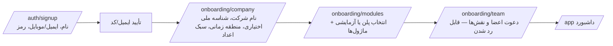

# ۰۷ — نقشه صفحات و جریان‌های کاربری

> وضعیت: پیش‌نویس فاز ۰ — منتظر تأیید

## ۱. نواحی SPA

| ناحیه | پیشوند | Layout | Guard | رندر |
|---|---|---|---|---|
| عمومی (لندینگ) | `/`، `/pricing`، … | PublicLayout (هدر ثابت، فوتر) | ندارد | **prerender ایستا** در build (vite-react-ssg) + hydrate |
| احراز هویت | `/auth/*` | AuthLayout | فقط مهمان | SPA |
| پنل شرکت | `/app/*` | AppShell (سربرگ، نوار کناری پویا، breadcrumb) | AuthGuard + TenantGuard + ModuleRouteGuard | SPA، lazy per module |
| پنل ادمین پلتفرم | `/console/*` (مسیر قابل تنظیم) | ConsoleShell | PlatformAuthGuard (ورود جدا + ۲FA اجباری) | SPA، chunk جدا |

ادمین پلتفرم در جدول کاربران جدا (`platform_admins`) با کوکی/توکن با audience متفاوت است؛ توکن پنل شرکت در کنسول پذیرفته نمی‌شود و برعکس.

## ۲. ناحیه عمومی

| مسیر | محتوا | منبع داده |
|---|---|---|
| `/` | بخش‌های ۱ تا ۱۴ پرامپت (Hero، مشکلات، ماژول‌ها، معماری ماژولار با SVG هسته/ماژول، مخاطبان، هلدینگ، امنیت، داشبورد، پلن‌ها، شروع کار، FAQ، فرم، فوتر) | پلن‌ها و FAQ و اطلاعات تماس: API عمومی؛ در prerender از API در زمان build خوانده و در runtime تازه می‌شود |
| `/modules` و `/modules/:id` | معرفی هر ماژول | محتوای ایستا در کد (متن بازاریابی) + وضعیت «در دسترس/به‌زودی» از API ماژول‌های عمومی |
| `/pricing` | جدول مقایسه پلن‌ها | `GET /api/public/plans` |
| `/about`، `/terms`، `/privacy` | متن | `platform_pages` (قابل ویرایش در کنسول) |
| `/contact`، `/demo` | فرم | `POST /api/public/leads` |
| `/sitemap.xml`، `/robots.txt` | تولید در build | |

**ادعاهای امنیتی لندینگ** فقط شامل موارد پیاده‌سازی‌شده و تست‌شده؛ فهرست آن‌ها در `docs/landing-claims.md` با ارجاع به تست مربوط نگهداری می‌شود (چک‌لیست بازبینی پیش از انتشار).

**تصویر محصول در Hero:** ماکت SVG ساخته‌شده از کامپوننت‌های واقعی `@mohandesyar/ui` با برچسب‌های آشکارا عمومی (مثل «پروژه نمونه»)، نه اسکرین‌شات از داده هیچ مشتری، و بدون اعداد آماری که ادعای واقعی بودن داشته باشند. (فرض ثبت‌شده؛ سؤال باز ۷.)

## ۳. احراز هویت و شروع کار

- `/auth/login` → اگر ۲FA فعال: `/auth/2fa`؛ اگر چند Tenant: `/auth/select-tenant`.
- `/auth/forgot`، `/auth/reset/:token`، `/auth/invite/:token`.
- تأیید ایمیل/پیامک وابسته به adapter؛ اگر هیچ adapter پیکربندی نشده باشد، ثبت‌نام عمومی به حالت «درخواست ثبت‌نام» می‌رود که ادمین پلتفرم تأیید می‌کند (فرض؛ سؤال باز ۴).

## ۴. پنل شرکت `/app`

### هسته
| مسیر | صفحه |
|---|---|
| `/app` | داشبورد (Widget Registry، چیدمان قابل تنظیم، فیلتر بازه/شرکت/پروژه/واحد) |
| `/app/tasks` | وظایف من / تیم |
| `/app/approvals` | کارتابل تأیید (همه گردش‌های کاری همه ماژول‌ها) |
| `/app/notifications` | اعلان‌ها |
| `/app/search?q=` | نتایج جست‌وجوی سراسری گروه‌بندی‌شده بر اساس Provider |
| `/app/reports` | فهرست گزارش‌های همه ماژول‌های فعال، فیلتر ذخیره‌شده، زمان‌بندی |
| `/app/imports` | ورود داده از Excel/CSV: انتخاب قالب → آپلود → پیش‌نمایش/خطا → اجرا → گزارش |
| `/app/profile` | پروفایل، رمز، ۲FA، نشست‌ها و «خروج از همه دستگاه‌ها» |
| `/app/settings/company` | اطلاعات شرکت‌ها، واحدها |
| `/app/settings/users` | کاربران، دعوت، نقش‌ها |
| `/app/settings/roles` | نقش‌ها و ماتریس مجوز |
| `/app/settings/grants` | دسترسی بین‌شرکتی (هلدینگ) |
| `/app/settings/modules` | ماژول‌های فعال، افزونه‌های قابل خرید، تنظیمات هر ماژول (فرم خودکار از اسکیما) |
| `/app/settings/workflows` | تعریف گردش‌های تأیید |
| `/app/settings/subscription` | پلن، مصرف (کاربر/فضا)، فاکتورها |
| `/app/settings/audit` | Audit Log Tenant |
| `/app/settings/support` | تیکت‌ها، درخواست‌های دسترسی پشتیبانی (تأیید/رد/لغو) |

### ماژول‌ها (هر کدام lazy و فقط در صورت فعال بودن)
| ماژول | مسیرهای اصلی |
|---|---|
| projects | `/app/projects`، `/:id` (تب‌ها: خلاصه، فعالیت‌ها/گانت، پیشرفت، گزارش‌های روزانه، مسائل و ریسک، درخواست تغییر، نقشه‌ها و اسناد، تحویل، بودجه*) |
| crm | `/app/crm/accounts`، `/leads`، `/pipeline` (کانبان)، `/opportunities/:id`، `/proposals`، `/reports` |
| contracts | `/app/contracts`، `/:id` (الحاقیه، تعهدات، تضامین، صورت‌وضعیت‌ها، تاریخچه) |
| meetings | `/app/meetings`، `/:id`، `/resolutions` (مصوبات معوق) |
| recruitment | `/app/recruitment/candidates`، `/:id`، `/jobs`، `/pipeline`، `/duplicates`، `/scoring` |
| hr | `/app/hr/employees`، `/:id`، `/leave`، `/reviews` |
| kpi | `/app/kpi/definitions`، `/scorecards`، `/values` (ورود دستی)، `/rewards` |
| finance | `/app/finance/accounts`، `/transactions`، `/payment-requests`، `/receivables`، `/budgets/:projectId`، `/cashflow`، `/reconciliation` |
| procurement | `/app/procurement/suppliers`، `/requests`، `/rfqs`، `/orders`، `/receipts`، `/invoices` |
| documents | `/app/documents` (درخت پوشه + فهرست)، `/:id` (نسخه‌ها، دسترسی، تأیید) |
| qhse | `/app/qhse/incidents`، `/inspections`، `/ncr`، `/capa`، `/training`، `/ppe` |
| holding | `/app/holding` (مقایسه شرکت‌ها) |
| hello-module | `/app/hello` |

\* تب‌های وابسته به ماژول اختیاری فقط در صورت فعال بودن آن ماژول نمایش داده می‌شوند (`useModule('finance')`).

## ۵. کنسول ادمین پلتفرم `/console`

| مسیر | صفحه |
|---|---|
| `/console` | نمای کلی: Tenantها، درآمد ماه، تیکت‌های باز، سلامت |
| `/console/modules` | فهرست ماژول‌ها (وضعیت، نسخه، وابستگی‌ها، تعداد Tenant فعال، وضعیت بارگذاری هر نمونه) |
| `/console/modules/install` | جادوگر: آپلود ← اعتبارسنجی (نتیجه هر بررسی) ← پیش‌نمایش (وابستگی، مجوز، جداول، مهاجرت‌ها، رویدادها) ← تأیید + ۲FA ← پیشرفت زنده (SSE لاگ) ← نتیجه |
| `/console/modules/:id` | جزئیات، نسخه‌ها، ارتقا/بازگشت، فعال‌سازی سراسری، Tenantها (فعال/غیرفعال تکی و گروهی)، تنظیمات، رابطه با پلن، تاریخچه عملیات، حذف نصب (جادوگر چندمرحله‌ای) |
| `/console/keys` | کلیدهای امضای مورد اعتماد |
| `/console/tenants` و `/:id` | مشتریان، ایجاد/تعلیق/فعال‌سازی، مصرف، ماژول‌ها، اشتراک، فاکتورها |
| `/console/plans` | پلن‌ها و ماژول‌های هر پلن، قیمت افزونه |
| `/console/discounts` | کدهای تخفیف |
| `/console/billing` | فاکتورها، ثبت پرداخت دستی، سررسیدها |
| `/console/reports` | رشد کاربران، درآمد |
| `/console/leads` | درخواست‌های دمو/تماس و وضعیت پیگیری |
| `/console/tickets` | تیکت‌ها |
| `/console/support-access` | درخواست‌های دسترسی موقت و نشست‌های فعال |
| `/console/announcements` | اطلاعیه‌ها |
| `/console/content` | FAQ، اطلاعات تماس، صفحات حقوقی، برندینگ |
| `/console/system` | سلامت سرویس‌ها، صف‌ها (BullMQ)، خطاهای اخیر، پشتیبان‌ها و آخرین آزمون بازیابی |
| `/console/audit` | Audit Log پلتفرم |
| `/console/admins` | ادمین‌های پلتفرم و نقش‌ها |

## ۶. جریان‌های کلیدی

### نصب ماژول از کنسول
1. مدیر فنی «نصب ماژول جدید» → انتخاب فایل `.mypkg` → آپلود (نوار پیشرفت).
2. سرور بررسی‌ها را انجام می‌دهد و فهرست چک با ✓/✗ برمی‌گرداند (امضا، کلید، checksum، manifest، نسخه هسته، وابستگی‌ها، تداخل‌ها، لینت مهاجرت).
3. پیش‌نمایش؛ اگر نسخه جدیدتر یک ماژول نصب‌شده است → جریان ارتقا با نمایش changelog و نوع مهاجرت‌ها (expand/contract).
4. «نصب» → مودال ۲FA → عملیات async (BullMQ) → صفحه لاگ زنده → نتیجه (موفق: لینک «فعال‌سازی برای Tenantها»؛ شکست: دلیل + تأیید «همه تغییرات برگردانده شد»).

### فعال‌سازی ماژول برای Tenant (توسط مدیر شرکت، در محدوده پلن)
`/app/settings/modules` → «فعال‌سازی» → بررسی وابستگی‌ها (پیشنهاد فعال‌سازی وابسته‌ها) → seed نقش‌ها و قالب‌ها → منو بلافاصله به‌روز می‌شود (invalidate کوئری `me/modules`).

### پرداخت (finance)
درخواست (کاربر الف) → گردش تأیید بر اساس مبلغ و سقف نقش (کاربر ب، ...) → «آماده پرداخت» → اجرا با ثبت مرجع بانکی (کاربر ج) → تراکنش executed و تغییرناپذیر. هر مرحله اعلان و Audit.

## ۷. حالت‌های اجباری هر صفحه

`loading` (اسکلتون) · `error` (پیام فارسی + تلاش مجدد + شناسه خطا) · `empty` (توضیح + اقدام اول در صورت مجوز) · `forbidden` (بدون افشای وجود رکورد) · `offline` (بنر سراسری؛ کوئری‌ها pause) · `pending mutation` (دکمه غیرفعال + نشانگر؛ جلوگیری از ارسال دوباره) · `module-disabled` / `subscription-read-only` (بنر توضیحی). هر کامپوننت صفحه از `<PageState>` در `@mohandesyar/ui` استفاده می‌کند تا هیچ حالتی جا نیفتد.
