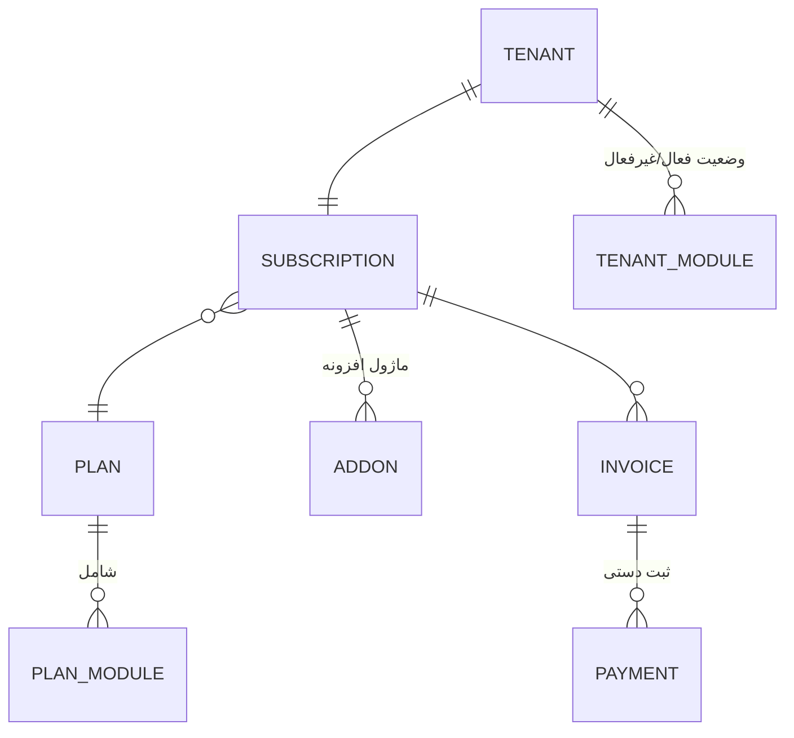
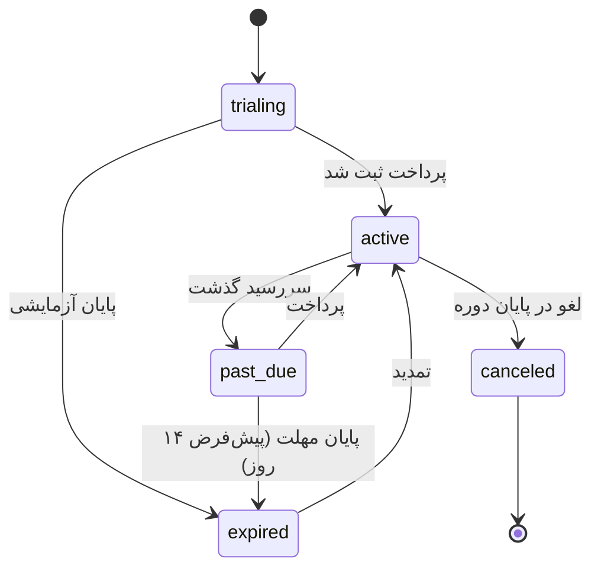

# ۰۹ — مدل اشتراک و Entitlement

> وضعیت: پیش‌نویس فاز ۰ — منتظر تأیید. قیمت‌ها هاردکد نمی‌شوند؛ هر عددی که در seed اولیه قرار گیرد فقط مقدار پیش‌فرض قابل ویرایش است و پیش از عرضه با تحقیق بازار جایگزین می‌شود.

## ۱. اجزا



- **پلن** (`core_plans`): نام، توضیح، قیمت ماهانه/سالانه، سقف کاربر، فضای ذخیره، ویژگی‌ها (`features` مثلاً `{ "holding": false, "scheduledReports": true, "apiAccess": false }`)، عمومی/خصوصی (پلن سازمانی سفارشی). پلن‌های پیش‌فرض seed: پایه، حرفه‌ای، سازمانی — بدون قیمت (قیمت را ادمین وارد می‌کند؛ لندینگ در نبود قیمت «تماس بگیرید» نشان می‌دهد).
- **ماژول در پلن** (`core_plan_modules`): included یا قابل خرید به‌عنوان افزونه با قیمت.
- **اشتراک**: یک اشتراک فعال برای هر Tenant؛ وضعیت‌ها:



## ۲. محاسبه Entitlement

```
entitled(tenant, module) =
     module ∈ plan.includedModules
  ∨  module ∈ subscription.activeAddons
  ∨  module ∈ tenant.manualGrants          // ادمین پلتفرم (قرارداد سازمانی، آزمایشی ماژول)
effective(tenant, module) =
     installed(module) ∧ globallyEnabled(module)
  ∧  entitled(tenant, module) ∧ tenantEnabled(tenant, module)
  ∧  ∀ d ∈ requiredDeps(module): effective(tenant, d)
accessMode(tenant, module) =
     subscription.status ∈ {trialing, active, past_due}  → 'full'
     subscription.status ∈ {expired, canceled}            → module.expiryPolicy ('read-only' | 'hidden-keep-data')
     tenant.status = suspended                             → 'read-only' (قابل تنظیم: 'blocked')
```

- نتیجه در Redis با کلید `ent:<tenantId>` کش می‌شود (TTL ۵ دقیقه + invalidate رویدادی با تغییر اشتراک/ماژول/پلن).
- **اجرا در سرور:** `EntitlementGuard` روی همه مسیرهای `/api/m/*`؛ در حالت `read-only`، متدهای `POST/PUT/PATCH/DELETE` با 402/403 و کد `SUBSCRIPTION_READ_ONLY` رد می‌شوند، به‌جز endpointهایی که صریحاً `@AllowInReadOnly` دارند (خروجی، جست‌وجو، گزارش).
- Worker هم پیش از اجرای jobهای ماژول (رویداد، گزارش زمان‌بندی‌شده) effective را بررسی می‌کند.
- **هیچ حذف خودکار داده** در هیچ وضعیتی.

## ۳. سهمیه‌ها

| سهمیه | اعمال |
|---|---|
| تعداد کاربر فعال | هنگام دعوت/فعال‌سازی کاربر؛ رسیدن به سقف → خطای توضیحی + پیشنهاد ارتقا. کاهش پلن کاربران موجود را غیرفعال نمی‌کند، فقط افزودن جدید را مسدود می‌کند. |
| فضای ذخیره | هنگام آپلود (جمع `core_files.size` به‌علاوه نسخه‌ها، شمارنده تراکنشی در `core_tenant_usage`)؛ هشدار در ۸۰٪ و ۹۵٪ |
| ویژگی‌ها (`features`) | `@RequireFeature('scheduledReports')` و `useFeature()` در فرانت |

## ۴. صورتحساب (نسخه اول)

- فاکتور داخلی با شماره ترتیبی پلتفرم، اقلام (پلن، افزونه، ظرفیت اضافه، خدمات راه‌اندازی/آموزش به‌صورت قلم دستی)، تخفیف، مالیات بر ارزش افزوده (نرخ قابل تنظیم).
- ثبت پرداخت دستی توسط مدیر فروش (روش، تاریخ، مرجع، پیوست رسید) → اشتراک تمدید.
- رابط `PaymentGatewayAdapter { createPayment, verify, refund }` تعریف می‌شود؛ پیاده‌سازی پیش‌فرض `ManualGateway`. درگاه‌های ایرانی (زرین‌پال، … ) در آینده به‌عنوان adapter.
- PDF فاکتور فارسی از زیرساخت گزارش.
- یادآور سررسید: اعلان + ایمیل ۷، ۳ و ۱ روز پیش از پایان دوره.

## ۵. مسیرهای درآمدی و پشتیبانی در مدل

| مسیر | پشتیبانی |
|---|---|
| اشتراک پایه | پلن |
| ماژول افزونه | `core_plan_modules.addon_price` + `core_subscription_addons` |
| ظرفیت کاربر/فضا | `user_limit_extra` / `storage_extra` با قیمت واحد در پلن |
| خدمات راه‌اندازی، انتقال داده، آموزش | اقلام دستی فاکتور |
| قرارداد سازمانی / استقرار اختصاصی | پلن خصوصی + `manualGrants` + `PLATFORM_MODE=dedicated` |

## ۶. تست‌ها

جدول حقیقت `accessMode` برای همه وضعیت‌ها × سیاست انقضا؛ سقف کاربر؛ سقف فضا با آپلود هم‌زمان (race)؛ مسدودبودن API ماژول خریداری‌نشده حتی با دستکاری کلاینت؛ عدم حذف داده پس از انقضا و بازگشت کامل پس از تمدید.
